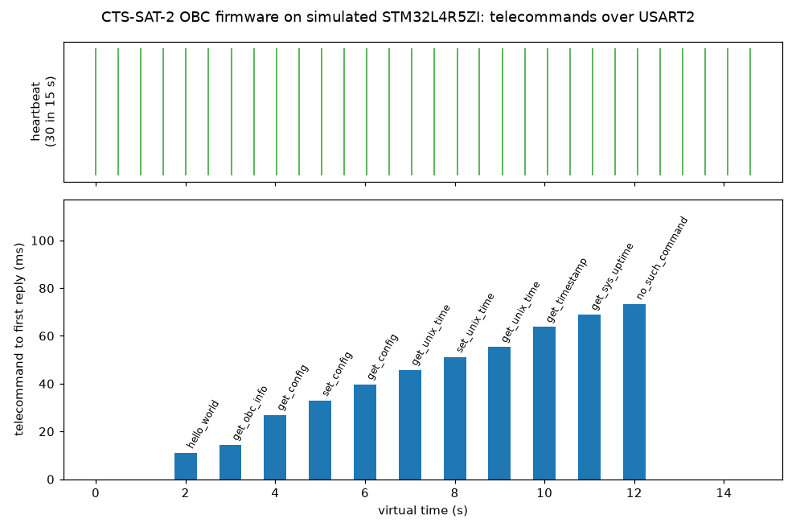
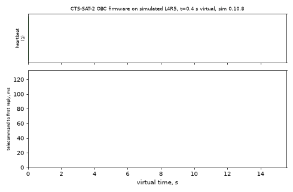

# CTS-SAT-2-OBC-Firmware

<!-- simantic-banner -->
> **Run this firmware with no hardware.** [Simantic](https://simantic.com) simulates the whole board, peripherals, sensors and buses included. Try it free at **[simantic.com](https://simantic.com)**, or run it locally: `curl -fsSL https://simantic.com/install | sh`

## This fork: the flight firmware on a simulated STM32L4R5ZI

Simantic's fork of CalgaryToSpace's CTS-SAT-2 OBC firmware. The upstream firmware at commit `0515f86` runs
unmodified (no firmware or source file is changed) on a simulated STM32L4R5ZI and is commanded over its umbilical UART
(USART2) the way a ground station does. No board, no bench. Everything is in [`sim/`](sim/).

```
cd sim && ./run.sh      # needs `sim` on PATH; the plot needs python3 + matplotlib
```





*Re-run on `sim` 0.10.8 (build 64f89c38), 2026-11-25: 15 s of virtual time, 39 s of CPU time (about 2.6 s per virtual second on a loaded laptop); the same checks pass, 30 heartbeats, uptime reply `11068 ms`. Drawn from `sim/run.log` by `sim/make_gif.py`.*

**Measured, from a real run** (`sim` 0.10.4, pyrite engine, [`sim/run.log`](sim/run.log), about 4.3 to 5 s of wall clock
for 15 s of virtual time):

- Boots to `USART2 ready. Buffered RX active.` at 1.4 ms, then prints `HEARTBEAT` every 0.5 s: 30 in 15 s.
- 11 telecommands sent 1 s apart from t = 2 s by [`sim/ground_peer.py`](sim/ground_peer.py); all answered, in order:
  `hello_world`, `get_obc_info` (version 0.1.0, commit `0515f86...`), `get_config`/`set_config` (`heartbeat_ms = U32(1000)`;
  `config_demo_variable1` set to and read back as `U32(456)`), `get_unix_time` (`ERR: Unix time not synchronized`, then
  after `set_unix_time` it answers `Unix time: 1791045406004 ms` 1 s later), `get_sys_uptime` (`11067 ms` at 11.07 s),
  and an unknown command (`ERR: Unknown telecommand`).
- No `HardFault` or panic. `run.sh` checks these strings and exits non-zero if one is missing.
- The reply latency in the plot (11 ms growing to 73 ms) is not a fixed cost: the firmware polls for telecommands once per
  heartbeat, and the 0.5008 s heartbeat period drifts against the ground peer's exact 1 s cadence.

**What is attached:** only the ground station on USART2 (circular RX DMA on DMA1 channel 6). This firmware revision
drives nothing else (a GPIOC PC7 LED, USART2, SysTick and the DWT cycle counter), so no I2C, SPI or other peers are
needed and none are invented. The scenario is [`sim/scenario.yaml`](sim/scenario.yaml); the ELF is built from upstream
without changes (provenance and build recipe: Simantic's `sim-fixtures`, `tests/stm/nucleo-l4r5zi/cts-sat-2-obc/`).

**Stubbed or not covered:** debug text goes to RTT, which `sim` does not capture, so only the UART console is seen. No
real hardware comparison has been done: everything here is simulator output. The firmware has no radio, ADCS, EPS or
storage code at this commit, so none of that is simulated.

**Findings** (firmware behaviour, not changed here; no simulator model bug found, no pyrite issue filed):
- `System reset cause: Brown Out` is printed on power-on: both BORRSTF and PINRSTF are set in RCC_CSR after reset and
  the firmware tests BORRSTF first.
- `get_timestamp` given a real NovAtel `#TIMEA` log answers `ERR: Too many arguments provided`, because the argument
  parser splits on the commas inside the log.
- `set_config` takes `u32(456)`, not `u32:456`.

Everything below is CalgaryToSpace's README.

---

Firmware for the CTS-SAT-2 mission. Runs on the STM32L4R5ZI-based Onboard Computer. 

## Getting Started
1. [Install Rust](https://rust-lang.org/tools/install/). It must be installed using `rustup`.
2. Install the required dependencies for embedded rust development.

```bash
rustup update
rustup target add thumbv7em-none-eabihf
rustup component add llvm-tools
cargo install cargo-binutils probe-rs-tools cargo-expand just
```
3. Install [SerialTest](https://github.com/wh201906/SerialTest/releases) or a similar serial terminal tool (must allow pre-writing a message before sending).
4. **[FOR WINDOWS USERS ONLY]**  Follow this link to install the [ST-Link Debugging Driver](https://www.st.com/en/development-tools/stsw-link009.html) for compataiblity with OpenOCD if not already installed.
   * Follow the instructions on the page to download latest.
   * Unzip the downloaded file and follow instructions in the readme (inside the zip file).
5. Open this repo in VS Code.
6. To flash and run the firmware, run `cargo embed --target thumbv7em-none-eabihf` from the root of this repo, with the Nucleo-L4A6ZG plugged in.
7. Observe logs coming from the STM32. Observe the green onboard LED blinking and logs in the debug terminal.
8. Disconnect power. Connect the USB-UART converter to the OBC's UART2 port.
    * Connect RX to TX, TX to RX, GND to GND. RXD pin on the STM is pin PD6, and TXD pin on the STM is pin PD5. All GND's on the STM can be used.
    * Google "nucleo-144 pinout" to find the UART2 pin locations.
    * Ask a friend for help!
9. Open SerialTest (or similar) and connect to the appropriate COM port at 115200 baud. Enable the "Suffix" checkbox.
    * You should see heartbeat messages every second.
10. Try sending the `CTS2+hello_world()!` command (every telecommand must contain the prefix `CTS2+` and the suffix `!`). You should receive a "HELLO_WORLD" response.

### Resources
- [STM32 Nucleo-144 Boards User Manual (UM2179)](https://www.st.com/resource/en/user_manual/um2179-stm32-nucleo144-boards-mb1312-stmicroelectronics.pdf)
  - Page 33 — Pinouts

## Command Quick Reference

* Run tests on host machine:

```sh
cargo test -p cts2_obc_logic
```

* Build and flash firmware to the OBC:

```sh
cargo embed --target thumbv7em-none-eabihf
```

* Build, test, and flash firmware at once:

```sh
cargo test -p cts2_obc_logic && cargo embed --target thumbv7em-none-eabihf
```
